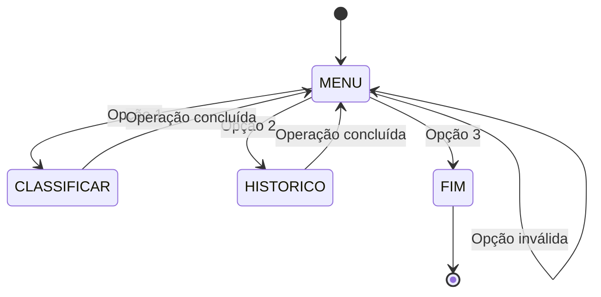

# EcoExpert — Sistema Especialista de Resíduos Domésticos

Protótipo acadêmico desenvolvido em **Python 3** para a disciplina **Inteligência Artificial e Linguagens Formais e Autômatos (LFA)** (UDF Centro Universitário — Profa. Kadidja Valéria).

O **EcoExpert** é um sistema especialista simbólico baseado em regras determinísticas que auxilia na classificação de resíduos domésticos (**Reciclável**, **Orgânico**, **Rejeito** ou **Descarte especial**) e apresenta a regra aplicada juntamente com a orientação de descarte.

---

## 📁 Estrutura do Repositório

```text
.
├── main.py                      # Motor de inferência, base de conhecimento e máquina de estados do menu
├── test_main.py                 # Testes automatizados (unittest)
├── README.md                    # Documentação do projeto
├── .gitignore                   # Arquivos ignorados pelo Git
├── registro de etica.pdf.pdf    # Diretrizes de Ética e Impactos da IA (UDF)
└── relatorio_ecoexpert.pdf      # Relatório técnico acadêmico do protótipo
```

---

## 🧠 Arquitetura e Regras de Produção

O sistema não utiliza aprendizado de máquina; todo o conhecimento é explícito e auditável por meio de regras determinísticas:

| Componente | Implementação |
| :--- | :--- |
| **Base de conhecimento** | Dicionário `BASE` com **21 resíduos** distribuídos em 4 categorias (`especial`, `reciclavel`, `organico`, `rejeito`). |
| **Normalização** | Função `normalizar()` remove acentos, converte para minúsculas e ajusta espaços extras. |
| **Motor de inferência** | Função `inferir()` avalia a pertinência em ordem de prioridade e retorna `(categoria, orientacao, regra)`. |
| **Memória de sessão** | Lista em memória que registra as consultas apenas durante a execução atual. |

### Regras de Produção (`R1` a `R5`)

| Regra | Condição e Conclusão |
| :--- | :--- |
| **R1** | **SE** pertence à lista `especial`, **ENTÃO** indicar **Descarte especial** (prioridade máxima). |
| **R2** | **SE** pertence à lista `reciclavel`, **ENTÃO** classificar como **Reciclável**. |
| **R3** | **SE** pertence à lista `organico`, **ENTÃO** classificar como **Orgânico**. |
| **R4** | **SE** pertence à lista `rejeito`, **ENTÃO** classificar como **Rejeito**. |
| **R5** | **SE** nenhuma regra for satisfeita, **ENTÃO** retornar **Não identificado**. |

---

## 🔄 Máquina de Estados do Menu

O fluxo de navegação é controlado por uma máquina de estados finita com conjunto de estados $Q = \{\text{MENU}, \text{CLASSIFICAR}, \text{HISTORICO}, \text{FIM}\}$:



---

## ▶️ Como Executar e Testar

### Pré-requisitos
- **Python 3.9+** instalado (sem dependências externas).

### Executar o sistema interativo
```bash
python main.py
```
*(No Windows, caso `python` não esteja no PATH, utilize `py main.py`.)*

### Executar os testes automatizados
```bash
python -m unittest -v
```
*(Ou `py -m unittest -v` no Windows.)*

---

## ⚖️ Análise Ética e Limitações

- **Privacidade e dados:** O sistema não coleta dados pessoais nem persiste informações em disco; o histórico existe apenas na memória da sessão.
- **Transparência:** Cada saída informa explicitamente a **regra aplicada** (`R1`–`R5`) e exibe um aviso de que se trata de recomendação automatizada por regras.
- **Supervisão e limitações:** O sistema reconhece apenas os termos exatos cadastrados (após normalização), não analisa imagens ou contaminação física dos materiais e depende da disponibilidade de coleta seletiva ou pontos de logística reversa do município do usuário. A revisão das regras cabe aos autores do projeto.

### Declaração de Uso de IA
- **IA incorporada ao projeto:** O sistema utiliza um **sistema especialista baseado em regras explícitas** (IA simbólica), sem modelos estatísticos ou generativos em tempo de execução.
- **IA utilizada na elaboração:** Ferramentas de IA generativa foram utilizadas como apoio na estruturação inicial do código, testes automatizados e documentação técnica, sendo todo o conteúdo revisado, testado e validado pelos integrantes do grupo.

---

## 📚 Referências
- FEIGENBAUM, E. A. *The art of artificial intelligence: themes and case studies of knowledge engineering*. Proceedings of IJCAI, p. 1014–1029, 1977.
- GOUVEIA, N. *Resíduos sólidos urbanos: impactos socioambientais e perspectiva de manejo sustentável com inclusão social*. Ciência & Saúde Coletiva, v. 17, n. 6, p. 1503–1510, 2012.
