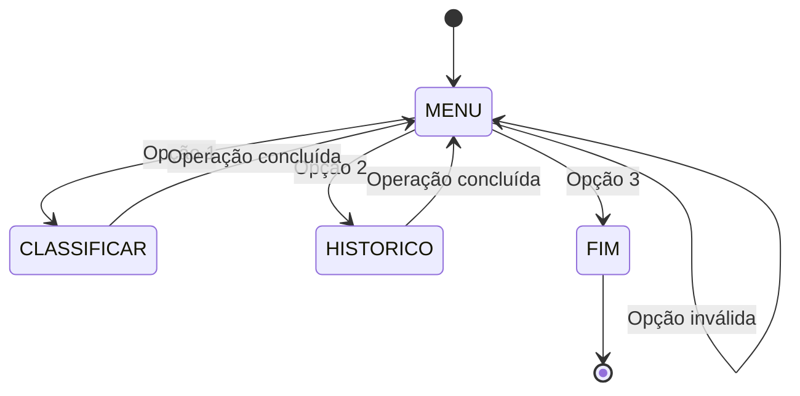

# ♻️ EcoExpert — Sistema Especialista de Resíduos Domésticos

[](https://colab.research.google.com/github/Nv777-Dev/Sistema-especialista-de-residuos-domesticos/blob/main/notebooks/EcoExpert_Colab.ipynb)


Protótipo acadêmico desenvolvido em **Python 3** para a disciplina **Inteligência Artificial e Linguagens Formais e Autômatos (LFA)** — **UDF Centro Universitário** (Profa. Kadidja Valéria).

O **EcoExpert** é um sistema especialista simbólico baseado em regras determinísticas que orienta a separação de resíduos domésticos (**Reciclável**, **Orgânico**, **Rejeito** ou **Descarte especial**), exibindo a regra aplicada e a recomendação de descarte.

---

## 🚀 Executar no Google Colab

Você pode executar o sistema, rodar os testes automatizados (`unittest`) e visualizar todas as validações diretamente no navegador clicando no botão abaixo:

👉 **[Abrir Notebook no Google Colab](https://colab.research.google.com/github/Nv777-Dev/Sistema-especialista-de-residuos-domesticos/blob/main/notebooks/EcoExpert_Colab.ipynb)**

---

## 📁 Estrutura do Repositório

```text
Sistema-especialista-de-residuos-domesticos/
├── notebooks/
│   └── EcoExpert_Colab.ipynb    # Notebook completo (código, testes unittest e validações)
├── docs/
│   ├── discussao_etica.pdf      # Síntese da discussão ética do projeto (1 página)
│   └── registro_de_etica.pdf    # Diretrizes de Ética e Impactos da IA (UDF)
├── main.py                      # Motor de inferência, base de conhecimento e menu (CLI)
├── test_main.py                 # Suíte de testes automatizados (unittest)
└── README.md                    # Documentação do projeto
```

---

## 🧠 Arquitetura e Regras de Produção

O sistema não utiliza aprendizado de máquina; todo o conhecimento é explícito, determinístico e auditável:

| Componente | Implementação |
| :--- | :--- |
| **Base de conhecimento** | Dicionário `BASE` com **21 resíduos** cadastrados em 4 grupos (`especial`, `reciclavel`, `organico`, `rejeito`). |
| **Normalização** | Função `normalizar()` remove acentos, converte letras para minúsculas e ajusta espaços extras. |
| **Motor de inferência** | Função `inferir()` verifica pertinência por ordem de prioridade e retorna `(categoria, orientacao, regra)`. |
| **Memória de sessão** | Lista mantida apenas em memória durante a execução atual para consulta do histórico. |

### Regras de Produção (`R1` a `R5`)

| Regra | Condição e Conclusão |
| :---: | :--- |
| **R1** | **SE** pertence à lista `especial`, **ENTÃO** indicar **Descarte especial** *(prioridade máxima)*. |
| **R2** | **SE** pertence à lista `reciclavel`, **ENTÃO** classificar como **Reciclável**. |
| **R3** | **SE** pertence à lista `organico`, **ENTÃO** classificar como **Orgânico**. |
| **R4** | **SE** pertence à lista `rejeito`, **ENTÃO** classificar como **Rejeito**. |
| **R5** | **SE** nenhuma regra for satisfeita, **ENTÃO** retornar **Não identificado**. |

---

## 🔄 Máquina de Estados do Menu

O controle de navegação é modelado por uma máquina de estados finita com conjunto de estados $Q = \{\text{MENU}, \text{CLASSIFICAR}, \text{HISTORICO}, \text{FIM}\}$:



---

## 💻 Como Executar e Testar Localmente

### Pré-requisitos
- **Python 3.9+** instalado (sem dependências externas).

### Executar o menu interativo
```bash
python main.py
```
*(No Windows, caso `python` não esteja no PATH, utilize `py main.py`.)*

### Executar os testes automatizados
```bash
python -m unittest -v
```
*(Ou `py -m unittest -v` no Windows.)*

---

## ⚖️ Análise Ética e Limitações

A síntese completa da discussão ética está disponível em [docs/discussao_etica.pdf](docs/discussao_etica.pdf).

- **Privacidade e dados:** O sistema não coleta dados pessoais nem armazena histórico permanente em disco.
- **Transparência:** Cada recomendação exibe explicitamente a **regra aplicada** (`R1`–`R5`) e informa que se trata de uma orientação automatizada por regras.
- **Supervisão e limitações:** Reconhece apenas os termos exatos cadastrados (após normalização), não analisa imagens ou contaminação física e depende das normas de coleta seletiva do município do usuário. A revisão das regras cabe aos responsáveis pelo projeto.

### Declaração de Uso de IA
- **IA incorporada ao projeto:** Sistema especialista baseado em regras explícitas (IA simbólica), sem uso de modelos estatísticos ou generativos em tempo de execução.
- **IA utilizada na elaboração:** Ferramentas de IA generativa auxiliaram na estruturação inicial do código, criação dos testes automatizados, notebook Colab e documentação, com revisão e validação integral pelos integrantes do projeto.

---

## 📚 Referências
- FEIGENBAUM, E. A. *The art of artificial intelligence: themes and case studies of knowledge engineering*. Proceedings of IJCAI, p. 1014–1029, 1977.
- GOUVEIA, N. *Resíduos sólidos urbanos: impactos socioambientais e perspectiva de manejo sustentável com inclusão social*. Ciência & Saúde Coletiva, v. 17, n. 6, p. 1503–1510, 2012.
